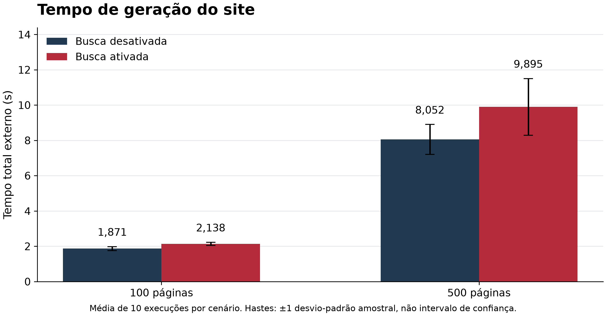
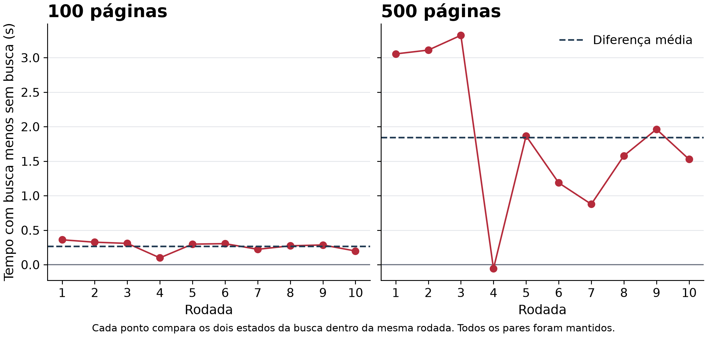

# Análise do impacto da busca no desempenho do MkDocs

Desenvolvemos um estudo experimental sobre o custo de habilitar o sistema de busca durante a geração de sites com **MkDocs 1.6.1**. O trabalho integra a disciplina **MC851A - Projetos de Software**, da **Universidade Estadual de Campinas (UNICAMP)**, ministrada pela professora **Islene Calciolari Garcia**.

O projeto foi realizado por **Alexandre Adler e André Macarini**. Ambos participaram do desenvolvimento, acompanharam a execução automatizada, analisaram os resultados e realizaram a revisão integral dos materiais. Este repositório reúne o procedimento experimental, os dados coletados, os gráficos e o [relatório final](relatorio/relatorio-final.pdf).

## 1 Descrição do projeto

Investigamos como a ativação do plugin `search` influencia o tempo total de execução de `mkdocs build`. Comparamos documentações sintéticas de 100 e 500 páginas, mantendo o mesmo conteúdo entre as condições com e sem busca de cada tamanho. O estudo não exigiu alterações no código-fonte do MkDocs.

## 2 Objetivos

- Medir o tempo total de geração nos quatro cenários definidos.
- Quantificar o acréscimo absoluto e relativo associado à busca.
- Observar como esse acréscimo varia entre 100 e 500 páginas.
- Investigar o funcionamento do plugin de busca no código oficial.
- Preservar os scripts e as evidências para reprodução e verificação.

## 3 Contextualização do MkDocs

O MkDocs é um gerador de sites estáticos escrito em Python. Ele transforma arquivos Markdown em HTML, utilizando configuração YAML, templates de tema e plugins. A ferramenta pode ser utilizada para manter a documentação de projetos de software junto ao código em um sistema de controle de versão.

O plugin `search` acompanha a distribuição e é habilitado por padrão. Durante o build, ele extrai conteúdo das páginas e prepara os dados utilizados pela busca no navegador. A configuração `plugins: []` desativa os plugins, inclusive a busca. Consultamos o [código do build na tag 1.6.1](https://github.com/mkdocs/mkdocs/blob/1.6.1/mkdocs/commands/build.py) e o [plugin de busca da mesma versão](https://github.com/mkdocs/mkdocs/blob/1.6.1/mkdocs/contrib/search/__init__.py).

## 4 Metodologia experimental

Geramos automaticamente dois corpora determinísticos, com semente 851. A contagem de páginas inclui `index.md`. Cada página contém parágrafos, seis seções, listas, blocos de código e links válidos para a página inicial. As primeiras 100 páginas do corpus maior são idênticas às do menor. Os estados da busca de cada tamanho compartilham o mesmo diretório de Markdown.

Mantivemos o tema `mkdocs` e as extensões `toc`, `tables` e `fenced_code`. Na condição com busca, fixamos:

```yaml
plugins:
  - search:
      lang: [pt]
      prebuild_index: false
      indexing: full
```

Na condição sem busca:

```yaml
plugins: []
```

Realizamos **40 medições**, dez por cenário, em 17/11/2026. Antes delas, executamos um aquecimento por cenário. Cada uma das dez rodadas executou os quatro cenários em ordem pseudoaleatória reproduzível. Cada build utilizou um processo Python novo, `--clean --strict` e uma saída exclusiva inicialmente ausente. O corpus e as saídas temporárias ficaram fora da pasta sincronizada pelo OneDrive.

Medimos o tempo externamente com `time.perf_counter_ns`, desde imediatamente antes da criação do subprocesso até a conclusão de `communicate`. A medida inclui inicialização, configuração, build e término do processo. A geração do corpus e a validação posterior ficaram fora do intervalo medido. O cache do sistema operacional não foi esvaziado.

Verificamos o retorno do comando, as páginas HTML esperadas e a presença ou ausência do índice em todos os builds. Nenhuma observação foi excluída. O piloto e os dois builds instrumentados com `cProfile` ficaram separados das 40 medições principais.

## 5 Cenários analisados

| Cenário | Páginas | Busca |
|---|---:|---|
| A | 100 | Ativada |
| B | 100 | Desativada |
| C | 500 | Ativada |
| D | 500 | Desativada |

O corpus e as configurações utilizados estão em [experimentos/corpus.zip](experimentos/corpus.zip). Os [manifestos dos arquivos Markdown](resultados/principal/corpus.json) registram tamanhos e hashes SHA-256.

## 6 Ambiente de execução

| Item | Configuração |
|---|---|
| Sistema operacional | Windows 11, build 26200 |
| Processador | AMD Ryzen AI 7 350 com Radeon 860M |
| Núcleos | 8 físicos e 16 lógicos |
| Memória física registrada | 15,29 GiB de RAM |
| Python | CPython 3.12.14, 64 bits |
| MkDocs | 1.6.1 |
| Markdown | 3.11.3 |
| Jinja2 | 3.1.6 |
| Click | 8.5.1 |
| Energia | Plano Balanced, bateria em 77% no início |

Registramos as versões completas e as características técnicas em [ambiente.json](resultados/principal/ambiente.json). As dependências estão congeladas em [requirements-lock.txt](experimentos/requirements-lock.txt).

## 7 Resultados obtidos

Os valores a seguir são médias de dez execuções por cenário:

| Páginas | Sem busca | Com busca | Acréscimo |
|---|---|---|---|
| 100 | 1,871 s | 2,138 s | 14,3% |
| 500 | 8,052 s | 9,895 s | 22,9% |

Calculamos o acréscimo relativo por `100 × (média com busca / média sem busca - 1)`, utilizando os valores completos antes do arredondamento. Os acréscimos absolutos foram 0,267 s e 1,843 s, respectivamente. **Esses percentuais representam os resultados observados no ambiente e no corpus utilizados, sem generalização para todos os projetos MkDocs.**

| Cenário | Média s | Mediana s | Desvio-padrão amostral s |
|---|---:|---:|---:|
| A | 2,138 | 2,130 | 0,087 |
| B | 1,871 | 1,872 | 0,111 |
| C | 9,895 | 8,976 | 1,606 |
| D | 8,052 | 7,942 | 0,846 |

As evidências estão disponíveis em:

- [40 medições principais em CSV](resultados/principal/medicoes.csv).
- [Registro completo com 40 medições e quatro aquecimentos em CSV](resultados/principal/tempos-brutos.csv).
- [Registro completo em JSON com ordem e comandos](resultados/principal/execucoes.json).
- [Estatísticas e diferenças por rodada](resultados/principal/resumo.json).
- [Logs individuais](resultados/principal/logs).
- [Conferência da preservação dos resultados na publicação](resultados/validacao-publicacao.json).

Os registros completos distinguem `phase: measured` e `phase: warmup`. Somente os primeiros entram nas estatísticas principais. A seleção de 40 linhas em `medicoes.csv` facilita a consulta e não substitui o registro completo.

## 8 Gráficos comparativos



As hastes representam um desvio-padrão amostral, e não um intervalo de confiança.



Cada ponto compara os dois estados da busca dentro da mesma rodada. As diferenças foram positivas em dez das dez rodadas de 100 páginas e em nove das dez rodadas de 500 páginas. Mantivemos a diferença ligeiramente negativa da rodada 4 do caso maior. Os gráficos também estão disponíveis em SVG e PDF na pasta [graficos](graficos).

## 9 Discussão técnica

Investigamos o funcionamento do comando no código oficial. O build reúne os arquivos e monta a navegação. Em seguida, `_populate_page` lê o Markdown e chama `Page.render`, que utiliza Python-Markdown para gerar HTML. `_build_page` aplica os templates Jinja2 e grava a saída.

Com busca ativada, `on_page_context` chama `add_entry_from_context` para analisar o HTML, extrair texto e relacionar seções ao sumário. Ao final, `on_post_build` serializa e grava `search/search_index.json`. Como `prebuild_index` foi `false`, o build preparou os dados usados pela busca no navegador, sem a pré-construção opcional do índice Lunr em Node.js.

Obtivemos 800 entradas de busca em 100 páginas e 4.000 em 500 páginas. O JSON ocupou aproximadamente 2,35 MiB e 11,75 MiB. Os dois [perfis de diagnóstico](resultados/principal/profiling/resumo-profiling.json) identificam operações relevantes de extração e serialização, mas seus tempos instrumentados não integram as médias do benchmark. Tempos cumulativos de funções aninhadas não devem ser somados.

A diferença entre os estados estima o custo de habilitar o recurso completo, incluindo recursos adicionais e caminhos condicionais do tema. Ela não isola apenas uma função. Identificamos como hipóteses de otimização a redução de processamento repetido de HTML e a investigação do custo de associar seções ao sumário; nenhuma dessas mudanças foi implementada ou avaliada neste estudo.

## 10 Dificuldades e limitações

Identificamos limitações no ambiente de execução. O notebook operou com bateria e plano Balanced, sem controle integral de temperatura, frequência de CPU, antivírus e tarefas de fundo. Os primeiros três tempos do cenário C foram maiores que os restantes. A dispersão de C foi maior que a de A, por isso interpretamos a diferença entre os percentuais com cautela.

Utilizamos uma máquina, um tema e conteúdo sintético. Dois tamanhos de corpus não permitem estabelecer uma lei geral de crescimento. O número de páginas e o volume de texto cresceram juntos. Também não medimos a latência das consultas de busca no navegador.

A tentativa opcional de medir memória no piloto capturou o lançador do Python no Windows. Rejeitamos essa métrica e não apresentamos valores de consumo de memória como resultados válidos.

## 11 Conclusões

Concluímos que habilitar a busca aumentou o tempo médio do build nos dois tamanhos avaliados e que o acréscimo absoluto foi maior em 500 páginas. A análise do código e o profiling ajudam a explicar o trabalho adicional, sem atribuir toda a diferença a uma operação isolada. Os objetivos experimentais foram atingidos e os resultados foram analisados e integralmente revisados pelos dois integrantes.

O [relatório final em PDF](relatorio/relatorio-final.pdf) apresenta a metodologia, os resultados, as dificuldades e a comparação entre objetivos planejados e alcançados. Também disponibilizamos [Markdown](relatorio/relatorio-final.md) e [DOCX](relatorio/relatorio-final.docx) editáveis.

## 12 Instruções para reprodução

### Instalação

Para reproduzir o ambiente de referência, utilize **Python 3.12 de 64 bits**. Na raiz do repositório:

```powershell
python --version
python -m venv .venv
.\.venv\Scripts\python.exe -m pip install -r requirements.txt
```

O arquivo raiz inclui as versões congeladas da coleta e a dependência da verificação documental. Em Linux ou macOS, o executável do ambiente fica em `.venv/bin/python`. As medições publicadas foram realizadas no Windows.

### Verificar os resultados existentes sem novos builds

```powershell
.\.venv\Scripts\python.exe experimentos/verificar_resultados.py
```

Esse comando confere as 40 medições, os aquecimentos, as estatísticas, os hashes do corpus, os registros de publicação e os links internos. Ele não executa o MkDocs nem altera os dados. Para recalcular as estatísticas e recriar gráficos em uma pasta temporária, sem novos benchmarks:

```powershell
$figuras = Join-Path $env:TEMP 'mc851-graficos-recalculados'
.\.venv\Scripts\python.exe experimentos/analisar.py --figures-dir $figuras
```

`analisar.py` regrava apenas o registro de validação da cópia analisada; não modifica os tempos coletados.

### Executar uma nova coleta

Este passo é opcional e deve ser realizado somente quando se deseja medir novamente. Escolha diretórios novos e mantenha o trabalho fora de pastas sincronizadas:

```powershell
$trabalho = Join-Path $env:TEMP ('mc851-trabalho-' + (Get-Date -Format 'yyyyMMdd-HHmmss'))
.\.venv\Scripts\python.exe experimentos/benchmark.py --work-dir $trabalho --output-dir resultados/reexecucao-local --repetitions 10
.\.venv\Scripts\python.exe experimentos/analisar.py --run-dir resultados/reexecucao-local --figures-dir graficos/reexecucao-local
```

Novas coletas recebem saídas próprias; os dados de `resultados/principal` devem ser preservados. Os tempos podem mudar conforme o hardware, o sistema e sua carga. O script [executar.ps1](experimentos/executar.ps1) também automatiza a criação de um ambiente e de uma pasta de coleta novos.

Para regenerar somente o relatório a partir dos registros existentes:

```powershell
.\.venv\Scripts\python.exe -m pip install -r requirements-relatorio.txt
.\.venv\Scripts\python.exe experimentos/gerar_relatorio.py
.\.venv\Scripts\python.exe experimentos/exportar_pdf.py
```

O gerador de PDF usa Arial do Windows e não depende do Word. A paginação do DOCX pode diferir da do PDF.

### Organização e privacidade dos registros

As cópias públicas mascaram caminhos locais por marcadores como `<EXECUCAO_LOCAL>` e `<PYTHON>`. Os campos experimentais, as contagens e os resultados foram preservados; os originais permanecem arquivados separadamente. As transformações e os hashes de origem e publicação estão documentados em [proveniencia-publicacao.json](resultados/proveniencia-publicacao.json) e na [política dos registros públicos](PRIVACIDADE.md).

As cópias consultadas do código oficial estão em [experimentos/fontes-oficiais](experimentos/fontes-oficiais), acompanhadas da licença BSD original. Os arquivos foram comparados com a tag 1.6.1, conforme [fontes.json](resultados/principal/fontes.json). Nenhum código do MkDocs foi modificado.

## 13 Autores

**Alexandre Adler e André Macarini** são os autores e responsáveis pelo trabalho acadêmico. Ambos participaram do desenvolvimento, acompanharam a execução automatizada dos experimentos, analisaram os resultados e realizaram a revisão integral dos materiais.

Disciplina MC851A - Projetos de Software, Engenharia de Computação, UNICAMP. Professora Islene Calciolari Garcia.

## 14 Uso de ferramentas de inteligência artificial

Durante o desenvolvimento do projeto, utilizamos o Codex como ferramenta de apoio à programação, automação de experimentos, organização de informações e elaboração dos materiais técnicos. Os procedimentos, resultados e conclusões foram acompanhados, analisados e integralmente revisados por Alexandre Adler e André Macarini, responsáveis pelo trabalho acadêmico.
