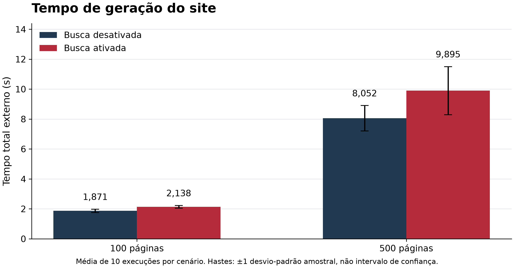
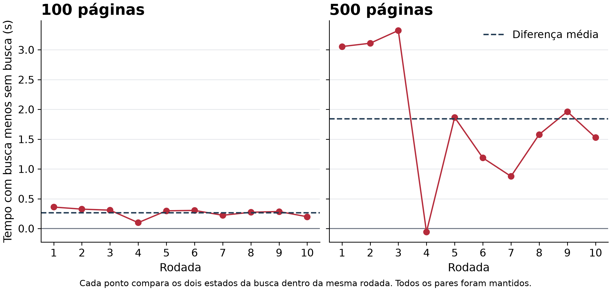

# Impacto da busca no desempenho do MkDocs

Relatório final de estudo experimental

Alexandre Adler
André Macarini
UNICAMP - Engenharia de Computação
MC851A - Projetos de Software
Professora Islene Calciolari Garcia
17 de novembro de 2026

## Resumo

Este estudo avaliou o custo de habilitar a busca no build do MkDocs 1.6.1 em documentação sintética de 100 e 500 páginas. Foram executados dez builds por cenário, além de aquecimentos, com medição externa do tempo total. A busca elevou a média em 0,267 s (14,3%) para 100 páginas e 1,843 s (22,9%) para 500 páginas. A dispersão foi maior nos cenários de 500 páginas. A análise do código e um profiling separado associam o custo adicional à extração de texto e à preparação dos dados de busca. Os resultados descrevem este ambiente e corpus, sem demonstrar um limite geral de escalabilidade.

## 1 Introdução

Sites de documentação apoiam o desenvolvimento e a utilização de projetos de software livre. Sua geração é repetida durante a edição e a integração do projeto. Recursos úteis, como busca, acrescentam trabalho ao processo de construção. Medir esse custo permite discutir uma escolha de configuração com evidências, sem implementar alterações no gerador.

## 2 Contextualização do MkDocs

O MkDocs é um gerador de sites estáticos escrito em Python. Ele combina arquivos Markdown, configuração YAML e templates de tema para produzir HTML e arquivos auxiliares. O mecanismo de plugins permite executar ações em eventos do build. A distribuição inclui o plugin search, habilitado por padrão; sua desativação exige uma lista de plugins vazia [1-5].

## 3 Objetivos

O objetivo foi comparar o tempo de mkdocs build com e sem busca, em 100 e 500 páginas. As questões específicas foram quantificar o custo absoluto e relativo da busca, observar a mudança entre os dois tamanhos e investigar componentes que ajudam a explicar o comportamento. Identificar oportunidades de otimização foi um objetivo de análise, sem implementar ou prometer uma melhoria no código.

<!-- Quebra de página no DOCX -->

## 4 Metodologia experimental

O desenho cruzou dois tamanhos de corpus com dois estados da busca. A e B compartilharam exatamente os mesmos 100 arquivos, enquanto C e D compartilharam os mesmos 500. A contagem inclui index.md. O gerador usou semente 851, seis seções por página, parágrafos, listas, blocos de código e links válidos para o início. As primeiras 100 páginas do corpus maior são idênticas às do menor. Os arquivos e respectivos hashes SHA-256 estão registrados no manifesto e no arquivo corpus.zip.

| Cenário | Páginas | Busca |
| --- | --- | --- |
| A | 100 | Ativada |
| B | 100 | Desativada |
| C | 500 | Ativada |
| D | 500 | Desativada |

Os corpora somaram 968.006 e 4.843.219 bytes de Markdown, respectivamente. Todos os casos utilizaram o tema mkdocs e as extensões toc, tables e fenced_code. Nos casos com busca, foram fixados lang: [pt], indexing: full e prebuild_index: false. Nos casos sem busca, foi usado plugins: []. Nenhum plugin de terceiros participou do build.

Cada execução iniciou um novo processo Python. O contador perf_counter_ns foi iniciado imediatamente antes de Popen e encerrado após communicate, cobrindo inicialização, leitura da configuração, build e término [6]. Foram utilizados --clean e --strict, uma saída exclusiva inicialmente ausente e timeout de 180 segundos. A geração do corpus, a validação de HTML e a análise ficaram fora do intervalo medido. PYTHONHASHSEED foi fixado em 0 e PYTHONPATH removido.

Após um aquecimento por cenário, foram realizadas dez rodadas. Cada rodada executou A, B, C e D em ordem pseudoaleatória reproduzível. Os 40 builds medidos foram sequenciais; nenhuma observação foi excluída. O cache do sistema operacional não foi esvaziado, portanto o estudo representa builds completos com arquivos previamente acessados, e não uma condição de disco frio.

## 5 Ambiente de execução

| Item | Configuração registrada |
| --- | --- |
| Sistema | Windows-11-10.0.26200-SP0 |
| Processador | AMD Ryzen AI 7 350 w/ Radeon 860M |
| CPU e memória | 8 núcleos físicos, 16 lógicos e 15,29 GiB de RAM |
| Python e MkDocs | CPython 3.12.14 de 64 bits e MkDocs 1.6.1 |
| Dependências principais | Markdown 3.11.3, Jinja2 3.1.6 e Click 8.5.1 |
| Energia e armazenamento | Plano Balanced, bateria em 77% no início; trabalho em disco local fora do OneDrive |

A execução ocorreu em 17/11/2026, com horários em UTC-03:00 registrados por build. O pacote foi instalado em ambiente virtual exclusivo. As dependências completas foram congeladas em requirements-lock.txt. O notebook manteve o plano de energia existente; carga de fundo e variação térmica não foram controladas integralmente.

<!-- Quebra de página no DOCX -->

## 6 Resultados dos quatro cenários

A Tabela 1 apresenta estatísticas dos dez tempos externos de cada cenário. O desvio-padrão é amostral, calculado com denominador n - 1. Os aquecimentos e os tempos instrumentados de profiling não integram essas estatísticas.

| Caso | Média s | Mediana s | DP s | Mínimo s | Máximo s |
| --- | --- | --- | --- | --- | --- |
| A | 2,138 | 2,130 | 0,087 | 2,013 | 2,301 |
| B | 1,871 | 1,872 | 0,111 | 1,716 | 2,056 |
| C | 9,895 | 8,976 | 1,606 | 8,567 | 12,636 |
| D | 8,052 | 7,942 | 0,846 | 7,101 | 9,581 |

Tabela 1 Tempos externos em segundos com dez execuções medidas por cenário

O impacto relativo foi calculado por 100 × (média com busca / média sem busca - 1). A diferença absoluta corresponde à média com busca menos a média sem busca.

| Páginas | Acréscimo médio s | Impacto relativo | Pares com acréscimo |
| --- | --- | --- | --- |
| 100 | 0,267 | 14,3% | 10 de 10 |
| 500 | 1,843 | 22,9% | 9 de 10 |

## 7 Gráficos comparativos

Figura 1 Média do tempo total por tamanho e estado da busca com hastes de um desvio-padrão amostral

Em 100 páginas, a média passou de 1,871 s para 2,138 s. Em 500, passou de 8,052 s para 9,895 s. O custo médio absoluto da busca aumentou entre os tamanhos estudados. O percentual também aumentou nesta amostra, mas essa diferença deve ser interpretada junto da maior dispersão nos casos de 500 páginas.

<!-- Quebra de página no DOCX -->

## 8 Discussão técnica

Figura 2 Diferenças entre busca ativada e desativada dentro de cada rodada

O emparelhamento por rodada reduz a distância temporal entre as condições comparadas, sem eliminar interferências. As diferenças foram positivas em 10 das dez rodadas de 100 páginas e em 9 das dez rodadas de 500. Na rodada 4 do caso maior, a diferença foi -0,057 s. Esse valor foi preservado, pois uma execução isolada mais rápida com busca é compatível com ruído do ambiente.

O coeficiente de variação do cenário C foi 16,2%, contra 4,1% em A. No caso de 500 páginas com busca, a média de 9,895 s ficou acima da mediana de 8,976 s. Os primeiros três tempos de C foram maiores que os restantes. Esse padrão temporal impede tratar toda a dispersão como efeito do plugin e recomenda cautela com diferenças percentuais pequenas.

Passar de 100 para 500 páginas multiplicou as médias por 4,63 com busca e 4,30 sem busca. Dois tamanhos não permitem estabelecer uma lei de crescimento ou afirmar complexidade assintótica. O número de páginas e o volume de texto cresceram juntos, enquanto a navegação também passou a conter mais itens.

O build carrega a configuração, descobre arquivos e monta a navegação. Em seguida, _populate_page lê o Markdown e chama Page.render. Essa função instancia Python-Markdown, converte o texto em HTML e extrai informações como títulos e âncoras. Depois, _build_page renderiza cada página com Jinja2 e grava a saída [1-2]. O cronômetro interno do MkDocs cobre uma parte menor desse fluxo que a medição externa utilizada aqui.

Com search ativado, on_page_context chama add_entry_from_context para cada página. O plugin analisa o HTML, coleta texto e relaciona seções ao sumário. Ao final, on_post_build serializa a coleção em search/search_index.json e grava os recursos necessários [3-4]. Como prebuild_index foi false, o build gerou dados para busca no navegador, sem executar a pré-construção opcional do índice Lunr em Node.js.

A validação encontrou 800 entradas e 2,35 MiB de JSON em A; em C, 4000 entradas e 11,75 MiB. Há oito entradas por página: a entrada geral, o título principal e seis seções. Com busca desativada, o arquivo de índice esteve ausente em todos os builds.

<!-- Quebra de página no DOCX -->

## Diagnóstico por profiling

Duas execuções adicionais, uma de C e outra de D, foram instrumentadas com cProfile. Elas servem para localizar funções com custo relevante, sem substituir as 40 medições principais. Os tempos cumulativos incluem funções chamadas internamente e não devem ser somados entre linhas aninhadas [7].

| Caso | Função | Chamadas | Tempo cumulativo s |
| --- | --- | --- | --- |
| C | _populate_page | 500 | 8,411 |
| D | _populate_page | 500 | 9,114 |
| C | _build_page | 500 | 10,487 |
| D | _build_page | 500 | 8,127 |
| C | add_entry_from_context | 500 | 2,068 |
| C | generate_search_index | 1 | 0,075 |

Tabela 2 Funções selecionadas das execuções instrumentadas de 500 páginas

Na execução instrumentada de C, add_entry_from_context acumulou 2,068 s em 500 chamadas, enquanto generate_search_index acumulou 0,075 s. A comparação indica onde o plugin realiza trabalho, mas não demonstra que esses tempos sejam iguais ao acréscimo médio do benchmark. O profiler altera o custo da execução, especialmente em trechos com muitas chamadas Python.

A geração de navegação e a renderização dos templates continuam presentes nos dois estados. Assim, desativar a busca não elimina a conversão Markdown nem a criação de links e HTML. A diferença A - B ou C - D estima o custo de habilitar o recurso completo, incluindo dados de busca, recursos estáticos e caminhos condicionais do tema. Ela não isola apenas json.dumps ou apenas a execução do plugin.

A auditoria comparou quatro arquivos do pacote instalado com cópias da tag oficial 1.6.1, normalizando somente terminações de linha e espaços finais do arquivo. Todos coincidiram. As URLs e hashes estão em resultados/principal/fontes.json; os arquivos consultados foram preservados em experimentos/fontes-oficiais. Nenhum trecho do código-fonte do MkDocs foi alterado.

## Reprodutibilidade e validação

Cada build foi verificado quanto ao retorno zero, presença de todas as páginas HTML esperadas e estado correto do índice. A análise recalculou média, mediana e desvio-padrão a partir do CSV e conferiu os resultados contra o JSON. A auditoria também verificou dez blocos completos, hashes do script e dos dados e ausência de exclusões de observações. Logs individuais, ordem dos cenários e comandos completos permitem rastrear cada resultado.

<!-- Quebra de página no DOCX -->

## 9 Dificuldades e limitações

O comando Python inicialmente disponível apontava para o ambiente de outro projeto. Foi criado um ambiente exclusivo com CPython 3.12.14. Os arquivos temporários dos builds ficaram fora do OneDrive, embora os registros e materiais finais permaneçam na pasta do projeto. Isso reduz uma fonte de interferência de disco sem produzir isolamento completo do sistema.

A tentativa de medir memória no piloto retornou o contador do lançador do ambiente virtual no Windows. Essa métrica foi rejeitada antes da série principal e os valores não foram utilizados. O consumo de memória permaneceu fora das conclusões por ser um requisito opcional. Uma futura medição precisaria acompanhar o processo Python real e possíveis descendentes.

Os testes usaram uma máquina, um sistema operacional, um tema e um corpus sintético. O notebook estava em plano Balanced e com bateria. Não houve controle integral de temperatura, frequência de CPU, antivírus ou tarefas de fundo. Os caches do sistema permaneceram ativos. Essas condições, junto da tendência temporal observada em C, limitam a precisão e a generalização dos percentuais. Nenhuma conclusão sobre latência da busca no navegador foi testada.

## 10 Progresso e objetivos alcançados

| Objetivo planejado | Resultado alcançado |
| --- | --- |
| Quatro cenários com 100 e 500 páginas | A, B, C e D executados e validados |
| Pelo menos cinco repetições | Dez por cenário, mais um aquecimento por cenário |
| Medição externa e estatísticas | 40 tempos, média, mediana e DP amostral |
| Comparação e interpretação | Gráficos e análise por rodada com todos os dados |
| Fundamentação no código | Tag 1.6.1 auditada e dois perfis de diagnóstico |
| Memória opcional | Método preliminar rejeitado e métrica não divulgada |
| Materiais das entregas | Relatório, textos dos formulários, slides e roteiro analisados e integralmente revisados pelos integrantes |

O trabalho avançou da definição do recorte para a preparação do ambiente, piloto, coleta, validação, análise do código e elaboração dos materiais. Os objetivos obrigatórios do estudo foram atendidos. Alexandre Adler e André Macarini participaram do desenvolvimento, acompanharam a execução automatizada, analisaram os resultados e realizaram a revisão integral dos materiais. A gravação do vídeo e a submissão das entregas seguem o cronograma da disciplina.

## Registro do uso de inteligência artificial

Durante o desenvolvimento do projeto, utilizamos o Codex como ferramenta de apoio à programação, automação de experimentos, organização de informações e elaboração dos materiais técnicos. Os procedimentos, resultados e conclusões foram acompanhados, analisados e integralmente revisados por Alexandre Adler e André Macarini, responsáveis pelo trabalho acadêmico.

<!-- Quebra de página no DOCX -->

## 11 Possíveis melhorias

Como continuidade experimental, seria útil repetir a mesma matriz com alimentação externa e maior controle de carga do sistema. Isso poderia reduzir a dispersão sem alterar a pergunta estudada. Uma medição correta de memória exigiria acompanhar a árvore de processos do Python no Windows.

No código, oportunidades para investigação incluem reduzir o processamento repetido de HTML na extração para busca e avaliar o custo de relacionar cada seção ao sumário. Diminuir o volume indexado com indexing: sections ou titles também é uma hipótese de configuração, com perda de cobertura de pesquisa. Essas opções não foram testadas neste projeto. Qualquer otimização precisaria preservar o índice e ser validada funcionalmente antes de uma afirmação de melhoria [3-4].

## 12 Conclusão

Neste corpus e ambiente, habilitar a busca acrescentou 0,267 s em média em 100 páginas e 1,843 s em 500 páginas. Os acréscimos relativos foram 14,3% e 22,9%. O custo absoluto cresceu com o tamanho estudado. O código e o profiling oferecem uma explicação plausível pela extração de conteúdo e preparação dos dados de busca, sem atribuir toda a diferença a uma função específica. A maior variabilidade em 500 páginas exige cautela na comparação dos percentuais. O estudo produziu um protocolo reproduzível e não requereu alterações no MkDocs.

## 13 Referências

[1] MkDocs 1.6.1 Código do comando de build. Disponível em https://github.com/mkdocs/mkdocs/blob/1.6.1/mkdocs/commands/build.py. Acesso em 17 nov. 2026.

[2] MkDocs 1.6.1 Conversão das páginas Markdown. Disponível em https://github.com/mkdocs/mkdocs/blob/1.6.1/mkdocs/structure/pages.py. Acesso em 17 nov. 2026.

[3] MkDocs 1.6.1 Plugin de busca. Disponível em https://github.com/mkdocs/mkdocs/blob/1.6.1/mkdocs/contrib/search/__init__.py. Acesso em 17 nov. 2026.

[4] MkDocs 1.6.1 Geração dos dados de busca. Disponível em https://github.com/mkdocs/mkdocs/blob/1.6.1/mkdocs/contrib/search/search_index.py. Acesso em 17 nov. 2026.

[5] MkDocs Guia de configuração de plugins. Disponível em https://www.mkdocs.org/user-guide/configuration/#plugins. Acesso em 17 nov. 2026.

[6] Python Contador de tempo de alta resolução. Disponível em https://docs.python.org/3.12/library/time.html#time.perf_counter. Acesso em 17 nov. 2026.

[7] Python cProfile e limites de profiling. Disponível em https://docs.python.org/3.12/library/profile.html. Acesso em 17 nov. 2026.

Dados primários do estudo: resultados/principal/tempos-brutos.csv, execucoes.json, ambiente.json e resumo.json. Código reprodutível: experimentos/benchmark.py, analisar.py e diagnostico.py.
